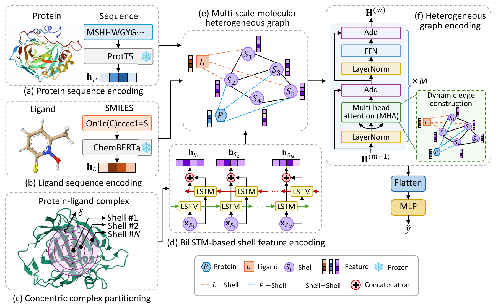

# MHGRL

Multi-scale Heterogeneous Graph Representation Learning for protein–ligand
binding affinity prediction.



## Environment

Run the training scripts on Linux or WSL with Python 3.10 and CUDA-enabled
PyTorch.

```bash
conda env create -f environment.yml
conda activate mhgrl
```

## Data and preprocessing

Obtain PDBbind v2020.R1, CASF-2016, and CSAR-HiQ from their respective sources.
The [dataset splits](data/splits/README.md) list the PDB IDs assigned to each
training, validation, and test set. Follow the same page to place the required
benchmark metadata locally. Structures, affinity labels, feature caches,
and model weights are not included.

Run the following commands from the repository root, with the dataset paths
set to your local copies.

```bash
PDBBIND=/path/to/PDBbind-v2020.R1
CASF=/path/to/CASF-2016
CSAR=/path/to/CSAR-HiQ

python preprocess/3_build_pyg_dataset.py --split all
python preprocess/build_paper_shell_features.py \
  --pdbbind_pl_root "$PDBBIND" --casf_root "$CASF" --csar_root "$CSAR" \
  --pdbbind_index data/splits/PL-2020R1.csv \
  --index_csvs data/splits/PL-2020R1.csv data/splits/CASF-2016.csv data/splits/CSAR-HiQ_dedup.csv
python preprocess/fit_split_scalers.py --split all \
  --features features_residue/paper/residue_N60_paper.npz \
  --out-root features_residue/paper/scalers/train_only
```

ProtT5 and ChemBERTa are frozen. To precompute their pooled embeddings:

```bash
python scripts/precompute_chemberta_features.py --device cuda:0
python scripts/precompute_prott5_cache.py --max-len 512 --pool residue_mean --device cuda:0
```

## Training and evaluation

```bash
for split in random scaffold seq_identity holdout base; do
  python "training/train_$split.py" --config "configs/$split.yaml" --device cuda:0
done
```

The base configuration evaluates on CASF-2016 and CSAR-HiQ. Metrics are saved
under `results/` with the mean and sample standard deviation across runs.
Use `--validation-only` to train and select checkpoints without loading the
test sets, or `--repeats 0` to select the first repeat.

In `configs/`, `fusion.topology_mode` selects the dynamic graph
(`dynamic`), the predefined graph (`predefined`), or reuse of the first
layer's graph (`first_layer`). Give an ablation a distinct `experiment.tag`
to keep its outputs separate.

## Tests

```bash
python -m unittest discover -s tests -p 'test_paper_*.py'
```
